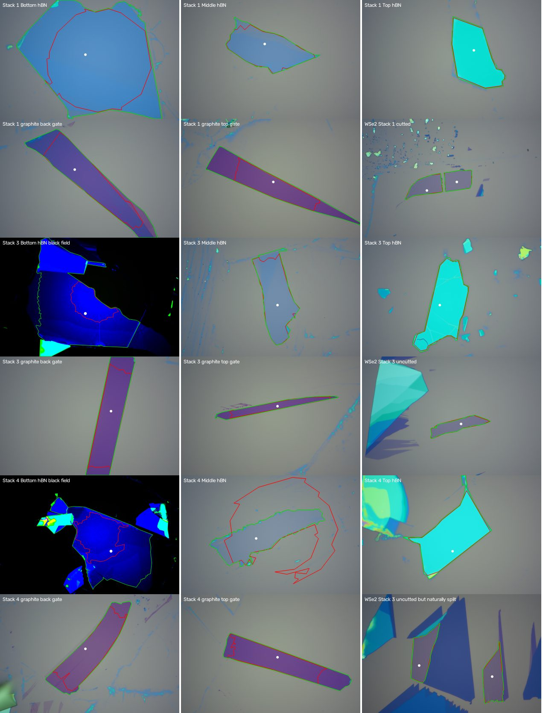

# Flake tracer benchmark (WSe2 batch 1)

Generated by `tools/trace_benchmark.py` from the lab's single-flake images in `WSe2 device training/Layer OM Image` (hBN, graphite and monolayer WSe2; two dark-field images). There are no hand-drawn reference borders, so the current tracer's borders were checked by eye on the overlays below; the numbers measure **stability**: the IoU between the border from the listed click and from 8 other clicks inside the same flake (mean / worst). *Auto* = IoU of the border found without any click with the clicked one. *Agree* = IoU between the two methods' borders from the same click.

| Image | click (px) | v0.3 wand mean / worst | current mean / worst | agree | auto | time (s) |
|---|---|---|---|---|---|---|
| Stack 1/Stack 1 Bottom hBN.png | 807, 517 | 0.74 / 0.70 | 1.00 / 1.00 | 0.69 | 1.00 | 0.14 |
| Stack 1/Stack 1 Middle hBN.png | 791, 416 | 0.85 / 0.59 | 1.00 / 0.99 | 0.93 | 1.00 | 0.07 |
| Stack 1/Stack 1 Top hBN.png | 1057, 476 | 0.99 / 0.99 | 1.00 / 1.00 | 0.95 | 1.00 | 0.13 |
| Stack 1/Stack 1 graphite back gate.png | 706, 480 | 0.70 / 0.15 | 1.00 / 0.99 | 0.74 | 1.00 | 0.07 |
| Stack 1/Stack 1 graphite top gate.png | 872, 597 | 0.66 / 0.13 | 0.99 / 0.99 | 0.58 | 0.99 | 0.09 |
| Stack 1/WSe2 Stack 1 cutted.png | 613, 678 | 0.97 / 0.94 | 1.00 / 1.00 | 0.97 | 0.00 | 0.03 |
| Stack 1/WSe2 Stack 1 cutted.png | 896, 597 | 0.99 / 0.99 | 1.00 / 0.99 | 0.98 | 1.00 | 0.03 |
| Stack 3/Stack 3 Bottom hBN black field.png | 1428, 1271 | 0.06 / 0.00 | 0.93 / 0.86 | 0.15 | 0.95 | 0.04 |
| Stack 3/Stack 3 Middle hBN.png | 912, 638 | 0.85 / 0.28 | 1.00 / 0.97 | 0.91 | 0.99 | 0.09 |
| Stack 3/Stack 3 Top hBN.png | 735, 638 | 0.99 / 0.98 | 1.00 / 1.00 | 0.95 | 1.00 | 0.11 |
| Stack 3/Stack 3 graphite back gate.png | 1049, 517 | 0.76 / 0.26 | 1.00 / 0.99 | 0.79 | 1.00 | 0.07 |
| Stack 3/Stack 3 graphite top gate.png | 912, 470 | 0.75 / 0.26 | 1.00 / 0.99 | 0.80 | 0.99 | 0.06 |
| Stack 3/WSe2 Stack 3 uncutted.png | 936, 638 | 0.99 / 0.98 | 1.00 / 0.99 | 0.95 | 1.00 | 0.03 |
| Stack 4/Stack 4 Bottom hBN black field.png | 1857, 1271 | 0.46 / 0.00 | 0.99 / 0.96 | 0.31 | 0.98 | 0.04 |
| Stack 4/Stack 4 Middle hBN.png | 710, 597 | 0.47 / 0.09 | 1.00 / 0.98 | 0.35 | 1.00 | 0.09 |
| Stack 4/Stack 4 Top hBN.png | 856, 718 | 1.00 / 1.00 | 1.00 / 1.00 | 0.93 | 1.00 | 0.13 |
| Stack 4/Stack 4 graphite back gate.png | 807, 517 | 0.91 / 0.81 | 1.00 / 1.00 | 0.79 | 1.00 | 0.06 |
| Stack 4/Stack 4 graphite top gate.png | 912, 597 | 0.74 / 0.27 | 1.00 / 1.00 | 0.71 | 1.00 | 0.11 |
| Stack 4/WSe2 Stack 3 uncutted but naturally split.png | 540, 675 | 0.99 / 0.97 | 1.00 / 0.99 | 0.98 | 0.99 | 0.06 |
| Stack 4/WSe2 Stack 3 uncutted but naturally split.png | 1230, 780 | 0.98 / 0.97 | 1.00 / 0.99 | 0.96 | 0.00 | 0.03 |

**Mean stability:** v0.3 0.79 (worst click 0.00); current 0.99 (worst click 0.86). **Auto pick:** the right flake on 18 of 18 images without a click (on a flake cut into two pieces it finds one of them — 'Next candidate' gives the other).

Red = v0.3 wand, green = current tracer, white dot = the click. The settings are `imaging.TRACE_DEFAULTS`.
