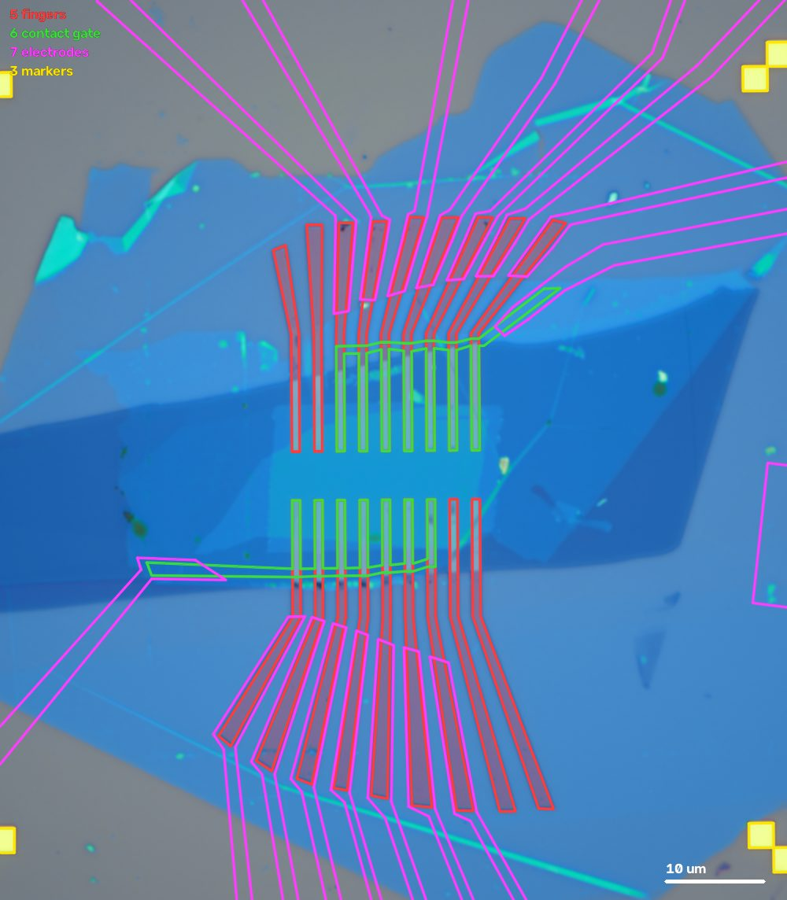
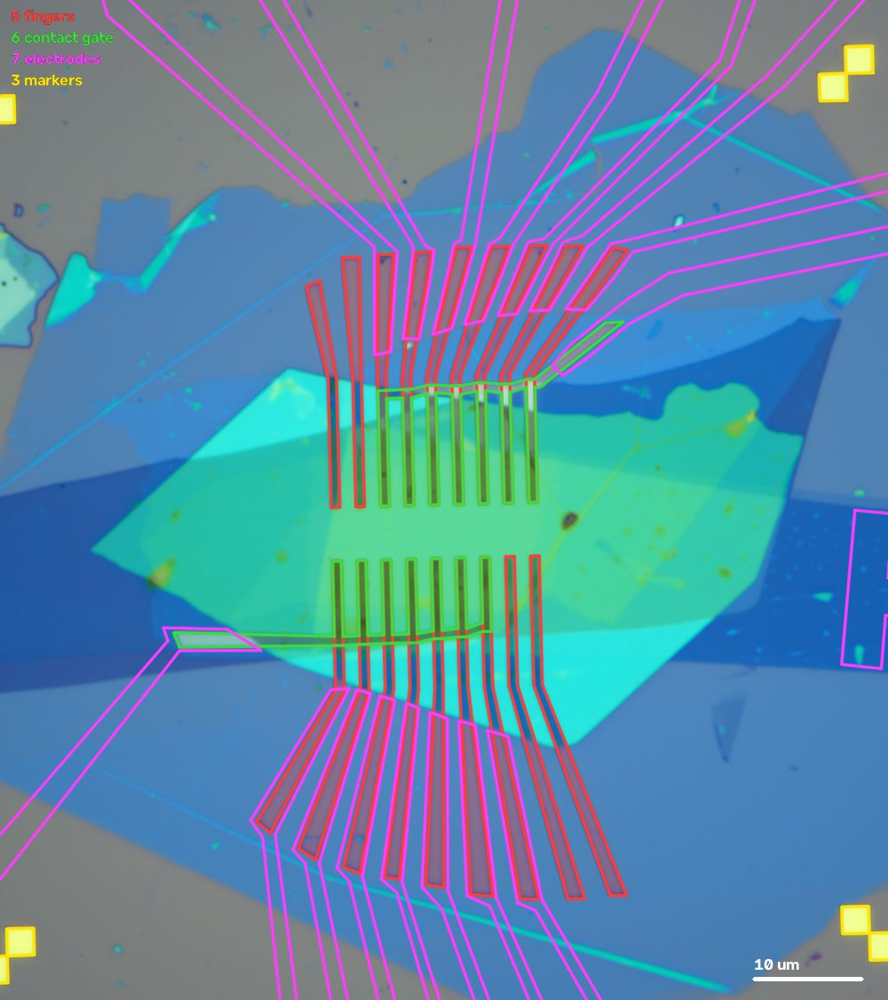
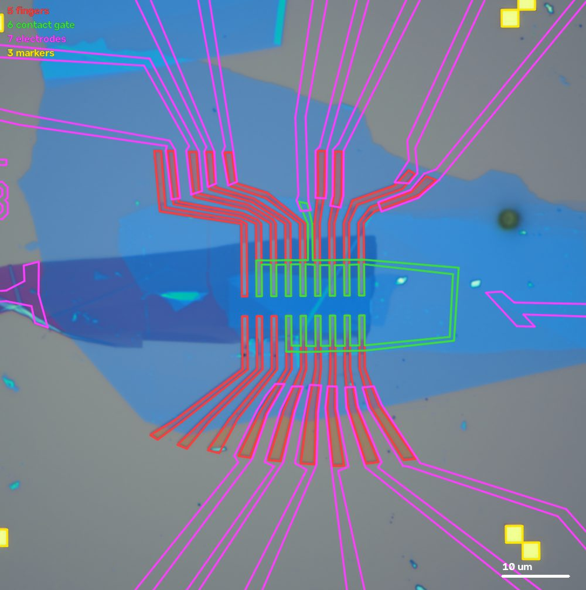
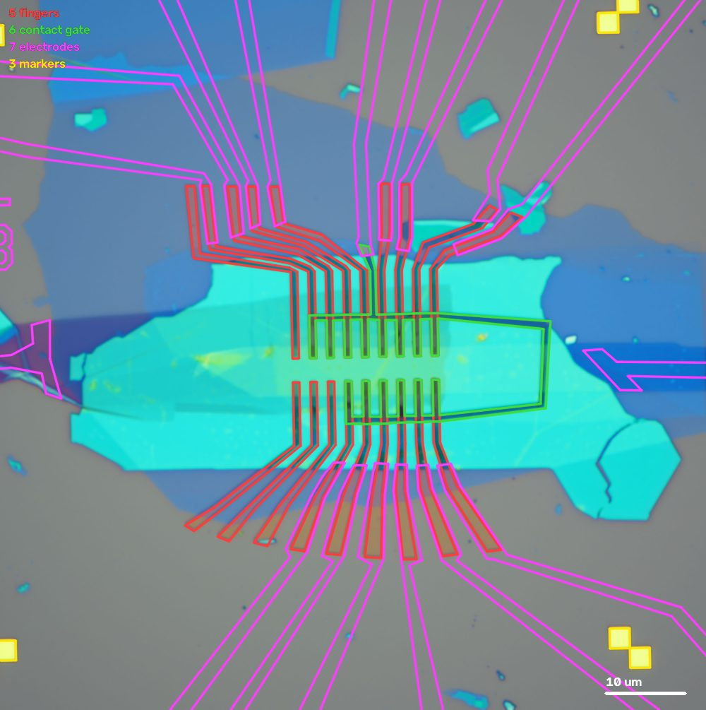
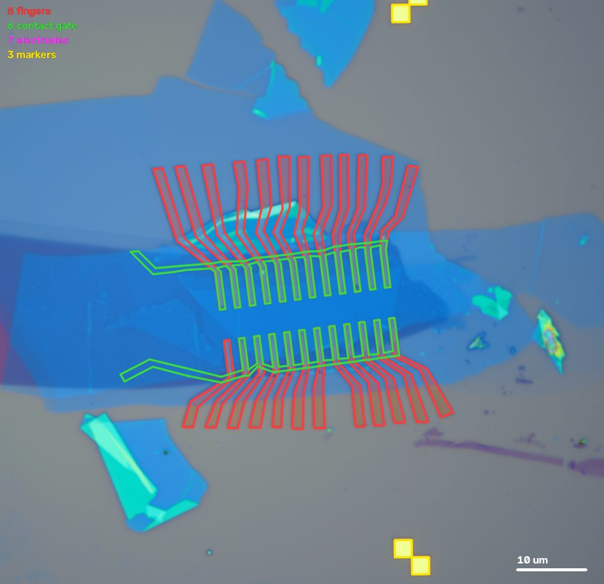

# tWSe2 batch 1: what the lab's own designs measure

> **These are measurements of the lab's own GDS drawings (Stack 1, 3, 4 of the tWSe2-1 KLayout session), made by `tools/learn_lab_designs.py` with `ustack/lab_designs.py`. They are not approved values.** None of them is written to `config/`. The lab has to confirm a number before it becomes a rule, preset or default (AGENTS.md rule 1).

## Data and method

- Session: `WSe2 device training/tWSe2-1_KLayout_session/tWSe2-1.lys`. Views in order: 1 = Stack 1.gds, 2 = Stack 3.gds, 3 = Stack 4.gds.
- Layer meanings: the user's message of 2026-11-16 (`WSE2_BATCH1_LAYERS`): 1 = device landing square, 3 = alignment markers, 4 = bond pads and fan-out, 5 = pre-patterned fingers ("hall bars") in two columns, 6 = contact gate, 7 = electrodes. The session names 5/0 *InnerContacts*, 6/0 *CG* and 7/0 *OuterContacts*.
- Local frame: the chip rotated so the fingers run along +v (top column at v > 0), origin at the middle of the column gap and of the finger array. *Tip* = the finger end at the gap; distances "from the tip" are along the finger axis.
- Widths come from slices across the finger axis (every 0.1 µm); the *straight section* ends where the centre or width changes by more than 0.01 µm. Mean widths and lengths of bent pieces are the equivalent strip (area A, half perimeter P/2: w·l = A, w + l = P/2). Electrode width near the device = the strip width of the electrode within ±10 µm of its innermost vertex.
- Electrodes count as near the device within 60 µm of the finger array. Layer-7 shapes there that touch none of layers 4/5/6 (text labels such as `S1`, `tWSe2 - 1`) are left out.
- Image placement: KLayout image matrix, u = col − W/2, v = H/2 − row, [x, y, w] = M·[u, v, 1]. 100x images come out at 0.0234, 0.0235 µm/px. Missing image files referenced by the session: `3 - tWSe2 stack/Picture5.png`, `Design/Picture1.png`, `Design/Picture3.png`, `Design/Picture4.png`.

## Per-stack measurements

| Quantity | Stack 1 | Stack 3 | Stack 4 |
|---|---|---|---|
| Finger axis on the chip (deg) | 89.99 | 89.99 | 97.04 |
| Fingers per column (top / bottom) | 9 / 9 | 9 / 9 | 12 / 12 |
| Finger width at the tip (µm) | 0.8 | 0.8 | 0.8 |
| Finger pitch at the tips (µm) | 2.3 | 2.2 | 2.2 |
| Finger spacing (edge-to-edge) at the tips (µm) | 1.5 | 1.4 | 1.4 |
| Column gap, tip to tip (µm) | 5 | 3 | 4.5 |
| Tips aligned: spread of tip line / top–bottom offset (µm) | 0.005 / 0.001 | 0.002 / 0.001 | 0.017 / 0.004 |
| Array span along the gap at the tips (µm) | 19.2 | 18.4 | 25 |
| Straight section from the tip = bend point (µm, top / bottom) | 12.04 / 12.04 | 10.91 / 8.03 | 5.53 / 5.51 |
| Finger centre-line length (µm, top / bottom median) | 24.57 / 30.61 | 28.18 / 23.19 | 21.11 / 15.44 |
| Finger extent along its axis (µm, top / bottom) | 23.56 / 30.56 | 21.77 / 21.79 | 20.55 / 14.38 |
| Full-length mean width (µm, top / bottom) | 0.93 / 1.03 | 0.79 / 1.07 | 1.02 / 0.96 |
| Width beyond the bend (µm, top / bottom) | 1.08 / 1.2 | 0.78 / 1.24 | 1.11 / 1.06 |
| Fan-out angle beyond the bend (deg, min–max, top) | -9.8–36.99 | -50.94–57.59 | -23.05–27.05 |
| Fan-out angle beyond the bend (deg, min–max, bottom) | -29.42–19.44 | -52.68–26.69 | -49.84–33 |
| Pitch at the far ends (µm, top / bottom) | 3.5 / 4.27 | 2.95 / 4.6 | 3.26 / 3.19 |
| Whole finger array (µm, along gap × across) | 35.83–60.91 | 43.27–47.57 | 39.16–41.55 |
| Contact-gate shapes | 2 | 1 | 2 |
| Fingers under the CG (top / bottom) | 7 / 7 | 8 / 6 | 12 / 12 |
| CG width on a finger (µm) | 0.8 | 0.8 | 0.8 |
| CG overlap along the finger from the tip (µm, top / bottom) | 11.07 / 7.76 | 5.37 / 5.34 | 6.78 / 5.5 |
| CG start, measured from the tip (µm) | 0 | 0 | 0 |
| CG clearance to the gap over the array (µm; 0 = flush with tips) | -0.001 | -0.001 | -0.009 |
| CG crosses the gap outside the array (distance from array, µm) | no | yes (12.97) | no |
| Layer-7 electrodes near the device | 18 | 17 | 0 |
| … on fingers / on CG / neither | 14 / 2 / 2 | 14 / 1 / 2 | 0 / 0 / 0 |
| Finger electrodes per column (top / bottom) | 7 / 7 | 8 / 6 | 0 / 0 |
| Electrodes on more than one finger | 0 | 0 | 0 |
| Floating fingers (no electrode; top / bottom) | 2 / 2 | 1 / 3 | 12 / 12 |
| Finger-electrode width near the device (µm, median) | 1.7 | 1.57 | – |
| Electrode width near the device, all (µm, min–max) | 1.42–3.52 | 1.15–2.18 | – |
| Min electrode–electrode spacing near the device (µm) | 0.54 | 0.76 | – |
| Median nearest-neighbour electrode spacing (µm) | 1.06 | 0.97 | – |
| Electrode lands on the finger at, from the tip (µm, median) | 15.34 | 13.11 | – |
| … landing point range (µm) | 11.88–17.83 | 10.21–16.8 | – |
| Electrode overlap length along the finger (µm, median) | 12.17 | 9.69 | – |
| … overlap length range (µm) | 7.98–17.19 | 2.69–13.44 | – |
| Min clearance electrode → other fingers (µm) | 1.01 | 0.58 | – |
| Min clearance finger electrode → CG (µm) | 2.04 | 1.47 | – |
| All electrodes reach layer 4 | yes | yes | – |
| 'Neither' electrodes: inner ends (u, v) µm | (39, 1); (-50.4, 1.9) | (-38.5, -3); (27.4, 1.8) | – |
| Landing square (layer 1): size / device offset from its centre (µm) | 400–400 / (0.7, -1.7) | 400–400 / (7.4, -4.2) | 400–400 / (24.9, -4.5) |
| Pad-free square around the device (half-size, µm) | 198.33 | 192.65 | 175.07 |

Stack 4 never reached the electrode step (no layer 7), so its electrode rows are empty and all its fingers count as floating.

## Consensus across the stacks

Median of the per-stack medians; the spread is the smallest and largest value seen on any column of any stack.

| Quantity | Median | Spread | Stacks |
|---|---|---|---|
| Finger width at the tip (µm) | 0.8 | 0.8 – 0.8 | Stack 1, Stack 3, Stack 4 |
| Finger pitch at the tips (µm) | 2.2 | 2.2 – 2.3 | Stack 1, Stack 3, Stack 4 |
| Finger spacing at the tips (µm) | 1.4 | 1.4 – 1.5 | Stack 1, Stack 3, Stack 4 |
| Column gap, tip to tip (µm) | 4.5 | 3 – 5 | Stack 1, Stack 3, Stack 4 |
| Fingers per column | 9 | 9 – 12 | Stack 1, Stack 3, Stack 4 |
| Array span at the tips (µm) | 19.201 | 18.401 – 25.004 | Stack 1, Stack 3, Stack 4 |
| Straight section from the tip (µm) | 9.47 | 5.511 – 12.041 | Stack 1, Stack 3, Stack 4 |
| Finger centre-line length (µm) | 25.684 | 15.437 – 30.61 | Stack 1, Stack 3, Stack 4 |
| Finger width beyond the bend (µm) | 1.087 | 0.78 – 1.238 | Stack 1, Stack 3, Stack 4 |
| Pitch at the far ends (µm) | 3.776 | 2.948 – 4.603 | Stack 1, Stack 3, Stack 4 |
| CG width on a finger (µm) | 0.8 | 0.8 – 0.801 | Stack 1, Stack 3, Stack 4 |
| CG overlap length from the tip (µm) | 6.142 | 5.337 – 11.067 | Stack 1, Stack 3, Stack 4 |
| CG clearance to the gap (µm) | -0.001 | -0.009 – -0.001 | Stack 1, Stack 3, Stack 4 |
| Finger-electrode width near the device (µm) | 1.639 | 1.573 – 1.705 | Stack 1, Stack 3 |
| Min electrode spacing near the device (µm) | 0.651 | 0.54 – 0.762 | Stack 1, Stack 3 |
| Median nearest-neighbour electrode spacing (µm) | 1.011 | 0.966 – 1.056 | Stack 1, Stack 3 |
| Electrode lands on the finger at, from the tip (µm) | 14.222 | 13.106 – 15.338 | Stack 1, Stack 3 |
| Electrode overlap length along the finger (µm) | 10.929 | 9.691 – 12.168 | Stack 1, Stack 3 |
| Min clearance electrode → other fingers (µm) | 0.795 | 0.578 – 1.012 | Stack 1, Stack 3 |
| 'Neither' (S/D by the layer rule) electrodes | 2 | 2 – 2 | Stack 1, Stack 3 |

## What the drawings show

- **Two facing columns of identical straight fingers.** Every finger is 0.8 µm wide at the tip; the tips of each column lie on one line and the top and bottom tips sit exactly opposite each other (offset ≤ 0.004 µm). Pitch 2.3 µm (Stack 1) and 2.2 µm (Stacks 3, 4), i.e. spacing 1.5 / 1.4 µm. The column gap changes with the flake: 5 µm (Stack 1), 3 µm (Stack 3), 4.5 µm (Stack 4).
- **Number of fingers follows the flake**: 9/9/12 per column; array span at the tips 19.2, 18.4, 25 µm.
- **Straight, then fan out.** The fingers run straight from the tip for 12 µm (Stack 1), 10.9 / 8 µm (Stack 3, top / bottom) and 5.5 µm (Stack 4), then bend outward (up to ±58° from the finger axis), mostly widen to ≈1.0–1.2 µm, and spread to a far-end pitch of ≈3–4.6 µm. Stack 3's top fingers have a second bend (dog-leg); its outer width stays 0.78 µm.
- **Stack 4's array is rotated** 7° on the chip (fingers at 97°); Stacks 1 and 3 are axis-aligned.
- **Contact gate = a comb on top of the fingers.** Each CG tooth is a copy of the finger tip it gates (same 0.8 µm width, starting flush with the tip, no side extension, no reach into the gap), 5.4–11.1 µm long, joined by a bus bar behind the teeth and led out sideways. Only the fingers that get an electrode are gated (Stack 1: 7 + 7 of 9 + 9; Stack 3: 8 + 6, the same fingers as the electrodes). Stack 1 and 4 draw one CG per column; Stack 3 draws one CG for both columns that crosses the gap 13 µm beside the array.
- **One electrode per finger, landing on the fanned part.** Every layer-7 finger electrode touches exactly one finger, starting 11.9–17.8 µm from the tip (beyond the CG teeth; min clearance to the CG 1.47 µm) and running 2.7–17.2 µm along it. Electrodes are ≈1.6–1.7 µm wide there; neighbouring electrodes come as close as 0.54 µm (Stack 1) / 0.76 µm (Stack 3). All reach layer 4 (the fan-out) about 200 µm out.
- **Floating fingers.** Stack 3: 1 top + 3 bottom finger(s) without an electrode (top #[0], bottom #[0, 1, 2], counted left to right), as the user said. **Stack 1 also leaves 2 + 2 fingers floating** (top #[0, 1], bottom #[7, 8]) and has no CG over them, so the same practice (connect only the fingers the flake reaches) seems to apply there; worth confirming with the lab.
- **The 'neither' electrodes (S/D by the layer rule) are not at the device.** Each stack has two, and they end on the gap axis (|v| ≤ 3 µm) far beyond the finger array: u = 39, -50.4 µm (Stack 1) and -38.5, 27.4 µm (Stack 3), with the array ending at ±9–10 µm. They end in a ≈3.5 µm-wide bar across the long dark strip that runs through the gap in the overlays (the back-gate flake), so they look like **back-gate contacts at both ends of the BG**, not source/drain. The lab's drawings have no dedicated S/D electrodes: any finger can serve as source or drain.
- **Landing square and markers.** Layer 1 holds a 400 × 400 µm square (plus the 6 mm write field and the 22 × 15 mm chip); the device sits within 25 µm of its centre. Near the device there are 2.5 µm checkerboard marker pairs (two squares touching at a corner) at (±40, ±40) µm from the square's centre; at the top-left corner one 2.5 µm square sits next to a 5 µm square (an orientation mark). 10 µm squares sit at (±195, ±195) µm. Pads/fan-out (layer 4) stay ≥ ≈175 µm from the device.

## Compared with UStack's rules and presets

| UStack value | UStack now (status) | Measured in the lab's drawings | Comment |
|---|---|---|---|
| `ebl.electrode_width_target_um` | 0.8 (approved) | finger tip width 0.8 µm in every stack; layer-7 electrodes 1.57–1.7 µm near the device | Fingers sit exactly on the target; the EBL electrodes are drawn about twice as wide. |
| `ebl.contact_width_min_um` | 0.5 (approved) | narrowest drawn finger 0.78 µm (Stack 3 outer part) | Above the hard minimum everywhere. |
| `ebl.electrode_spacing_target_um` | 0.8 (approved) | finger spacing at the tips 1.4–1.5 µm; electrode–electrode min 0.54–0.76 µm | Fingers are well above the target; the layer-7 fan-out goes **below** the 0.8 µm target (a DRC warning in UStack). |
| `ebl.contact_spacing_min_um` | 0.4 (pending) | electrode–electrode min 0.54 µm | Above the hard minimum. |
| `hall_bar.n_probe_pairs` (preset) | 2 | 9, 9, 12 fingers per column (Stacks 1, 3, 4) | The lab draws as many fingers as fit along the flake, not 2 pairs. |
| `hall_bar.width_per_arm` (preset): W = this × arm width | 3 → W = 2.4 µm | Mak layout: W = column gap = 5, 3, 4.5 µm, i.e. 3.75–6.25 × the finger width | The gap is set by the BG / flake, not by a ratio to the arm width. |
| `hall_bar.pitch_per_width` (preset): pitch = this × W | 2 → 6–10 µm for these gaps | pitch 2.2–2.3 µm = finger width + 1.4–1.5 µm | The lab's pitch is set by width + spacing (≈2.75× the finger width), independent of W; pitch/W = 0.46–0.73. |
| `prepattern.tmd_overlap_spacings` (preset): device reaches this × spacing onto each electrode | 2 → 1.6 µm | not in the GDS (needs the flake outline); the straight part of each finger is 5.5–12 µm | Measure on the traced flake; the straight finger length bounds how far the flake may reach before the fingers fan out. |
| Mak electrode length = overlap + 2·gate margin (Configure) | g = max(shift 2, 1 × spacing) → 5.6 µm | straight finger section 5.5–12 µm, whole finger 15.4–30.6 µm | The lab's fingers are much longer and fan out to meet the EBL electrodes. |
| `cg.reach_spacings` (preset): CG inner / outer reach and side extension = this × spacing | 1 → 0.8 µm each | CG starts flush with the tip (inner reach 0), side extension 0 (same 0.8 µm width as the finger), length 5.3–11.1 µm | Different shape: a comb of finger-width teeth, not a band. |
| `ebl.contact_overlap_um` | 1 (approved) | layer-7 electrode overlap on a finger 9.7–12.2 µm (median per stack) | Different meaning (1D-contact overlap in UStack); the lab's metal-on-metal overlap is long. |

## Where the lab's design differs from UStack's Hall-bar model

1. **Terminal count.** `hallbar.HallBar` has n probe pairs (preset 2) + S + D, one finger per terminal. The lab draws 9–12 identical fingers per column (18–24 terminals), one electrode each, and leaves the fingers the flake does not reach floating.
2. **No source/drain legs.** UStack's bent S/D (legs of width `leg_w`, flush with the channel ends, running `arm_l` to ±y) has no counterpart: every finger is the same, so S and D are chosen among the fingers at measurement time. The two layer-7 electrodes that touch neither 5 nor 6 end 27–50 µm away along the gap axis, on the back-gate strip, i.e. they are BG contacts (one at each end), not S/D.
3. **No channel polygon.** In UStack the pattern is a Hall-bar body (W × L) with arms; here the "channel" is the gap between the tip lines (W = 3–5 µm) and L is the finger span (18–25 µm). Probe pitch is width + spacing (2.2–2.3 µm), not 2 × W.
4. **Finger shape.** UStack arms are straight rectangles of `arm_l`. The lab's fingers are straight for 5.5–12 µm from the tip, then bend (one or two bends, up to ≈±58°), mostly widen to ≈1.0–1.2 µm and fan out to a 2.9–4.6 µm pitch, ending 14–31 µm from the tip (along the finger axis); the EBL electrodes land on the fanned part, beyond the CG.
5. **Contact gate.** UStack's contact gate is a band region with inner / outer reach and side extension (`cg.reach_spacings`). The lab's CG is a comb: one tooth per *contacted* finger, exactly the finger width, from the tip outward 5–11 µm, joined by a bus bar behind the teeth; one CG per column (Stacks 1, 4) or one for both columns crossing the gap beside the array (Stack 3).
6. **Back gate.** UStack's Mak preset puts the BG in the gap (BG = channel + 2g, gap W = bottom hBN + 2·shift). The overlays show the dark BG strip running through the gap far beyond the array, contacted at both ends by layer-7 bars; UStack's BG geometry has no such contacts drawn by the pattern step.
7. **Two EBL steps per device.** Layer 5 (fingers) is written before stacking (pre-pattern), layer 6 (CG) and layer 7 (electrodes, BG contacts) after; Stack 4 shows the state after the CG design but before layer 7. UStack's step list (pre-pattern contacts, contact gates, …) matches this order, but its Hall-bar geometry does not generate these finger / comb shapes.

## Overlays

Red = layer 5 fingers, green = layer 6 contact gate, magenta = layer 7 electrodes, yellow = layer 3 markers, drawn with the session's image matrix on the aligned 100x bright-field images and cropped around the device.

**Stack 1**, `3 - tWSe2 stack/AFM clean/WSe2_device_Stack1_after_tip_clean_100x_BF.jpg` (0.0235 µm/px)



**Stack 1**, `TS/WSe2_device_Batch1_before_electrodes_stack1_100x_BF.jpg` (0.0235 µm/px)



**Stack 3**, `3 - tWSe2 stack/AFM clean/WSe2_device_Stack3_after_tip_clean_100x_BF.jpg` (0.0235 µm/px)



**Stack 3**, `TS/WSe2_device_Batch1_before_electrodes_stack3_100x_BF.jpg` (0.0235 µm/px)



**Stack 4**, `3 - tWSe2 stack/AFM clean/WSe2_device_Stack4_after_tip_clean_100x_BF.jpg` (0.0235 µm/px)



## Reproduce

```
~/Library/Caches/UStack-build/venv-arm64/bin/python tools/learn_lab_designs.py
```
